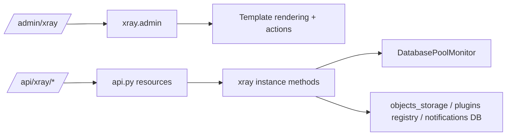

# XRAY - Technical Reference

## Module Structure

Core files:

| File | Responsibility |
| --- | --- |
| `plugins/xray/__init__.py` | Plugin lifecycle, admin UI routing, maintenance actions, widgets |
| `plugins/xray/api.py` | REST API endpoints for pool, analytics, and thread pools |
| `plugins/xray/utils/pool_monitor.py` | DB pool sampling, history, and monitoring thread |
| `plugins/xray/templates/xray_main.html` | Tab container/navigation for admin page |
| `plugins/xray/templates/xray_db.html` | DB info, pool monitoring cards/charts, table actions |
| `plugins/xray/templates/xray_thread_pools.html` | Thread pools metrics and charts |
| `plugins/xray/templates/xray_analytics.html` | Vue + Chart.js analytics frontend |
| `plugins/xray/templates/widget_xray.html` | Default dashboard widget |
| `plugins/xray/templates/widget_batch_writer.html` | Batch writer widget |

---

## Runtime Architecture

`xray` extends `BasePlugin` and registers:

- admin page handler (`admin(...)`);
- REST namespace (`/api/xray/...`);
- widgets (`default`, `batch_writer`);
- background DB pool monitor thread.

### Initialization flow

1. `initialization()` creates `DatabasePoolMonitor(engine, logger)`.
2. Sampling interval:
3. `1s` when `Config.DEBUG == True`.
4. `5s` otherwise.
5. `start_monitoring(interval)` starts daemon thread and appends history snapshots.

### High-level component flow



---

## Admin Tab Routing

`admin(request)` routes by query parameter `tab`:

| `tab` value | Template | Main data source |
| --- | --- | --- |
| empty | `xray_cycles.html` | `plugins` registry, cycle-capable modules |
| `cache` | `xray_cache.html` | Flask cache backend |
| `objects` | `xray_objects.html` | `objects_storage.getStats()` |
| `props` | `xray_props.html` | `objects_storage.getAdvancedStats()` |
| `methods` | `xray_methods.html` | `objects_storage.getAdvancedStats()` |
| `notifications` | `xray_notifications.html` | `Notify` table |
| `db` | `xray_db.html` | `__get_table_info()`, `__get_db_info()` |
| `thread_pools` | `xray_thread_pools.html` | `/api/xray/thread_pools/stats` |
| `threads` | `xray_threads.html` | `threading.enumerate()` |
| `cleaner` | `xray_cleaner.html` | `objects_storage.getCleanerStat()` |
| `system` | `xray_system.html` | python/flask/package metadata |
| `analytics` | `xray_analytics.html` | `/api/xray/analytics/stats` |

---

## Admin Operations (`op=...`)

Admin operations are processed via query parameter `op`:

| Operation | Parameters | Behavior |
| --- | --- | --- |
| `read` | `notify=<id>` | Mark one notification as read |
| `unread` | `notify=<id>` | Mark one notification as unread |
| `remove` | `notify=<id>` or `object=<name>` | Delete notification or remove object from storage |
| `read_all` | none | Mark all notifications read + set `SystemVar.UnreadNotify=false` |
| `clear_notifications` | none | Delete all notifications + set `SystemVar.UnreadNotify=false` |
| `clear_cache` | none | `cache.clear()` |
| `clear_storage` | none | `objects_storage.clear()` |
| `clear_table` | `table=<name>` | `DELETE FROM <table>` |
| `drop_table` | `table=<name>` | `DROP TABLE <table>` |
| `install_package` | `package=<name>` | Runs `python -m pip install <package>` |
| `start` / `stop` / `restart` | `cycle=<plugin_name>` | Controls plugin cycle thread |

> [!WARNING]
> `clear_table` and `drop_table` use interpolated table names into SQL text after dialect-specific quoting. It is an admin-only path and should still be treated as high risk.

---

## Database Introspection

### `__get_table_info()`

Builds table list with:

- table name;
- row count;
- estimated/actual size;
- owning module inferred from SQLAlchemy registry.

Dialect-specific behavior:

- PostgreSQL: `pg_total_relation_size(...)`, XML-based dynamic counts;
- MySQL: `information_schema.tables` (`data_length + index_length`);
- SQLite: table list + `COUNT(*)`, DB size from pragma page count/size.

### `__get_db_info()`

Returns normalized dictionary:

- `type`, `version`, `database_name`, `database_size`;
- connection string fragment;
- connection counters;
- tables/indexes/views counts;
- connection usage percent;
- uptime/charset/collation when available.

Includes fallback queries and value normalization for unknown/missing fields.

---

## Pool Monitor Internals

`DatabasePoolMonitor` stores `PoolStats` snapshots:

```python
PoolStats(
  active_connections,
  idle_connections,
  total_connections,
  pool_size,
  max_overflow,
  overflow,
  timestamp,
  pool_usage_percent,
  overflow_usage_percent
)
```

Key behavior:

- thread-safe history (`_lock`);
- in-memory ring-like retention (`max_history = 1000`);
- filtering by time window in `get_stats_history(minutes)`.

---

## REST API

Namespace path:

```text
/api/xray
```

All endpoints require:

- `api_key_required`;
- admin permission check (`handle_admin_required`).

### `GET /database/pool/stats`

Returns current pool snapshot from monitor.

Error:

- `503` with `{"error":"Pool monitoring not available"}` if monitor is missing.

### `GET /database/pool/history?minutes=60`

Returns:

- filtered history array;
- requested period;
- record count.

Each history item includes:

- `active_connections`;
- `idle_connections`;
- `total_connections`;
- `overflow`;
- `timestamp`;
- `usage_percent` (computed as `active / pool_size * 100`).

### `GET /database/pool/health`

Returns synthetic health:

- `health_score` (0..100);
- `status`: `healthy` / `warning` / `critical`;
- `warnings` list;
- `recommendations` list.

Score logic currently based on `pool_usage_percent`.

### `GET /analytics/stats`

Returns raw advanced object stats:

```json
{
  "stats": { "...": "..." },
  "timestamp": 1234567890.0
}
```

### `GET /thread_pools/stats`

Returns monitoring payload for:

- linked property pool;
- say pool;
- playsound pool;
- batch writer.

### `GET /thread_pools/history`

Currently returns the same payload as `/thread_pools/stats`.

---

## Frontend Polling and Rendering

### Database tab (`xray_db.html`)

Client polling every 30s:

- `/api/xray/database/pool/stats`;
- `/api/xray/database/pool/health`;
- `/api/xray/database/pool/history`.

Renders:

- KPI cards;
- Chart.js line chart for active connections and usage%.

### Thread Pools tab (`xray_thread_pools.html`)

Client polling every 30s:

- `/api/xray/thread_pools/stats`.

Renders:

- per-pool utilization cards;
- batch writer health block;
- utilization and execution-time charts;
- recent tasks table.

### Analytics tab (`xray_analytics.html`)

Client polling every 30s:

- `/api/xray/analytics/stats`.

Runs in-browser aggregation:

- operations per object;
- top methods by count and by execution time;
- activity age buckets;
- source distribution;
- simple health visualization.

---

## Widgets

`widgets()` returns:

1. `default`
2. `batch_writer`

`widget(name)` behavior:

- `batch_writer`: fetches `_batch_writer.get_stats()` and renders dedicated template.
- default: computes cycle service counts + object storage size.

---

## Known Caveats

> [!WARNING]
> In `pool_monitor.py`, warning/error thresholds are checked as `if >80` then `elif >90`; the `>90` branch is unreachable. The order likely should be reversed.

Additional caveats:

- `/thread_pools/history` does not provide separate historical series (same payload as stats endpoint).
- `install_package` executes synchronous `pip install` from web request context.
- `drop_table` operation is immediately destructive.
- no explicit `stop_monitoring()` call is wired in plugin shutdown path in this module file.

---

## Summary

`XRAY` is the operational diagnostics surface of osysHome:

- UI diagnostics hub;
- runtime maintenance endpoint;
- DB pool monitor;
- thread-pool and analytics viewer;
- lightweight service control panel.

See also:

- [User Guide](USER_GUIDE.md)
- [Module index](index.md)
