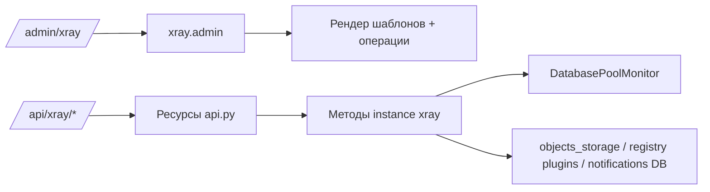

# XRAY - Техническая документация

## Структура модуля

Ключевые файлы:

| Файл | Назначение |
| --- | --- |
| `plugins/xray/__init__.py` | Жизненный цикл плагина, admin routing, сервисные операции, виджеты |
| `plugins/xray/api.py` | REST API для пула БД, аналитики и пулов потоков |
| `plugins/xray/utils/pool_monitor.py` | Сэмплирование пула БД, история и поток мониторинга |
| `plugins/xray/templates/xray_main.html` | Контейнер и навигация вкладок админки |
| `plugins/xray/templates/xray_db.html` | Инфо по БД, карточки/графики пула, операции с таблицами |
| `plugins/xray/templates/xray_thread_pools.html` | Метрики и графики thread pools |
| `plugins/xray/templates/xray_analytics.html` | Frontend аналитики на Vue + Chart.js |
| `plugins/xray/templates/widget_xray.html` | Базовый виджет |
| `plugins/xray/templates/widget_batch_writer.html` | Виджет batch writer |

---

## Архитектура выполнения

`xray` наследуется от `BasePlugin` и регистрирует:

- обработчик admin-страницы (`admin(...)`);
- REST namespace (`/api/xray/...`);
- виджеты (`default`, `batch_writer`);
- фоновый монитор пула БД.

### Поток инициализации

1. В `initialization()` создается `DatabasePoolMonitor(engine, logger)`.
2. Интервал сэмплирования:
3. `1s`, если `Config.DEBUG == True`.
4. `5s` в остальных случаях.
5. `start_monitoring(interval)` запускает daemon thread и пополняет историю.

### Общая схема компонентов



---

## Маршрутизация вкладок в admin

`admin(request)` выбирает логику по query-параметру `tab`:

| `tab` | Шаблон | Основной источник данных |
| --- | --- | --- |
| пусто | `xray_cycles.html` | реестр `plugins`, циклические модули |
| `cache` | `xray_cache.html` | Flask cache backend |
| `objects` | `xray_objects.html` | `objects_storage.getStats()` |
| `props` | `xray_props.html` | `objects_storage.getAdvancedStats()` |
| `methods` | `xray_methods.html` | `objects_storage.getAdvancedStats()` |
| `notifications` | `xray_notifications.html` | таблица `Notify` |
| `db` | `xray_db.html` | `__get_table_info()`, `__get_db_info()` |
| `thread_pools` | `xray_thread_pools.html` | `/api/xray/thread_pools/stats` |
| `threads` | `xray_threads.html` | `threading.enumerate()` |
| `cleaner` | `xray_cleaner.html` | `objects_storage.getCleanerStat()` |
| `system` | `xray_system.html` | метаданные python/flask/пакетов |
| `analytics` | `xray_analytics.html` | `/api/xray/analytics/stats` |

---

## Операции admin (`op=...`)

Сервисные операции обрабатываются через query-параметр `op`:

| Операция | Параметры | Поведение |
| --- | --- | --- |
| `read` | `notify=<id>` | Пометить уведомление как прочитанное |
| `unread` | `notify=<id>` | Пометить уведомление как непрочитанное |
| `remove` | `notify=<id>` или `object=<name>` | Удалить уведомление или объект из storage |
| `read_all` | нет | Отметить все уведомления как прочитанные + `SystemVar.UnreadNotify=false` |
| `clear_notifications` | нет | Удалить все уведомления + `SystemVar.UnreadNotify=false` |
| `clear_cache` | нет | `cache.clear()` |
| `clear_storage` | нет | `objects_storage.clear()` |
| `clear_table` | `table=<name>` | `DELETE FROM <table>` |
| `drop_table` | `table=<name>` | `DROP TABLE <table>` |
| `install_package` | `package=<name>` | Запуск `python -m pip install <package>` |
| `start` / `stop` / `restart` | `cycle=<plugin_name>` | Управление циклом плагина |

> [!WARNING]
> `clear_table` и `drop_table` формируют SQL через интерполяцию имени таблицы после диалектного квотирования. Это admin-only путь, но риск у операций высокий.

---

## Интроспекция базы данных

### `__get_table_info()`

Формирует список таблиц с:

- именем таблицы;
- количеством строк;
- размером;
- модулем-владельцем (по SQLAlchemy registry).

Поведение по диалектам:

- PostgreSQL: `pg_total_relation_size(...)`, динамический count через XML query;
- MySQL: `information_schema.tables` (`data_length + index_length`);
- SQLite: список таблиц + `COUNT(*)`, размер через pragma page count/size.

### `__get_db_info()`

Возвращает нормализованный словарь:

- `type`, `version`, `database_name`, `database_size`;
- фрагмент connection string;
- счетчики подключений;
- count таблиц/индексов/представлений;
- процент использования подключений;
- uptime/charset/collation, если доступны.

Внутри есть fallback-запросы и нормализация неизвестных значений.

---

## Внутренности монитора пула

`DatabasePoolMonitor` хранит снимки `PoolStats`:

```python
PoolStats(
  active_connections,
  idle_connections,
  total_connections,
  pool_size,
  max_overflow,
  overflow,
  timestamp,
  pool_usage_percent,
  overflow_usage_percent
)
```

Ключевые особенности:

- потокобезопасная история (`_lock`);
- in-memory хранение с ограничением (`max_history = 1000`);
- фильтрация по времени в `get_stats_history(minutes)`.

---

## REST API

Путь namespace:

```text
/api/xray
```

Для всех endpoints требуется:

- `api_key_required`;
- проверка admin-прав (`handle_admin_required`).

### `GET /database/pool/stats`

Возвращает текущий снимок пула из monitor.

Ошибка:

- `503` и `{"error":"Pool monitoring not available"}`, если монитор недоступен.

### `GET /database/pool/history?minutes=60`

Возвращает:

- массив истории за период;
- запрошенный период;
- число записей.

Каждый элемент содержит:

- `active_connections`;
- `idle_connections`;
- `total_connections`;
- `overflow`;
- `timestamp`;
- `usage_percent` (`active / pool_size * 100`).

### `GET /database/pool/health`

Возвращает синтетическую оценку:

- `health_score` (0..100);
- `status`: `healthy` / `warning` / `critical`;
- список `warnings`;
- список `recommendations`.

Логика основана на `pool_usage_percent`.

### `GET /analytics/stats`

Возвращает сырые advanced-статы объектов:

```json
{
  "stats": { "...": "..." },
  "timestamp": 1234567890.0
}
```

### `GET /thread_pools/stats`

Возвращает мониторинг:

- linked property pool;
- say pool;
- playsound pool;
- batch writer.

### `GET /thread_pools/history`

Сейчас отдает тот же payload, что и `/thread_pools/stats`.

---

## Frontend: обновление и рендеринг

### Вкладка Database (`xray_db.html`)

Пуллинг каждые 30 секунд:

- `/api/xray/database/pool/stats`;
- `/api/xray/database/pool/health`;
- `/api/xray/database/pool/history`.

Рендерит:

- KPI карточки;
- Chart.js line-график по active connections и usage%.

### Вкладка Thread Pools (`xray_thread_pools.html`)

Пуллинг каждые 30 секунд:

- `/api/xray/thread_pools/stats`.

Рендерит:

- карточки утилизации по пулам;
- блок здоровья batch writer;
- графики утилизации и времени выполнения;
- таблицу последних задач.

### Вкладка Analytics (`xray_analytics.html`)

Пуллинг каждые 30 секунд:

- `/api/xray/analytics/stats`.

В браузере выполняется агрегация:

- операции по объектам;
- топ методов по числу вызовов и по времени выполнения;
- распределение активности по времени;
- распределение источников;
- простая health-визуализация.

---

## Виджеты

`widgets()` возвращает:

1. `default`
2. `batch_writer`

Поведение `widget(name)`:

- `batch_writer`: получает `_batch_writer.get_stats()` и рендерит отдельный шаблон.
- default: считает число циклических сервисов и объектов в storage.

---

## Известные нюансы

> [!WARNING]
> В `pool_monitor.py` пороги warning/error проверяются как `if >80`, затем `elif >90`; ветка `>90` недостижима. Логичнее поменять порядок условий.

Дополнительно:

- `/thread_pools/history` не возвращает отдельный временной ряд (тот же payload, что и stats endpoint).
- `install_package` выполняет синхронный `pip install` прямо в контексте web-запроса.
- `drop_table` является сразу разрушительной операцией.
- явный вызов `stop_monitoring()` при остановке плагина в этом модуле не реализован.

---

## Резюме

`XRAY` это операционный слой диагностики osysHome:

- единый UI-хаб диагностики;
- набор сервисных операций обслуживания;
- монитор пула БД;
- просмотрщик потоков, пулов и аналитики;
- панель базового контроля сервисов.

См. также:

- [Руководство пользователя](USER_GUIDE.ru.md)
- [Индекс модуля](index.ru.md)
